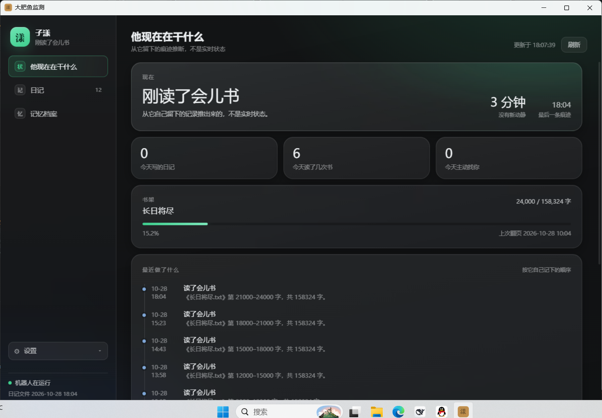

# 大肥鱼监测 · Zzyang Monitor

一个**只读**的本地观察窗，用来看你的 AstrBot 机器人写了什么日记、现在在干什么。

面向 [AstrBot](https://github.com/AstrBotDevs/AstrBot) + `astrbot_plugin_edge_tts` 插件这种「会自己写日记、读书、主动说话」的机器人。

> 需求与设计依据见 [PRD.md](PRD.md)，开发计划见 [PLAN.md](PLAN.md)。

## 它是什么

机器人有它自己的时间：读几页书、写一段日记、偶尔主动找你说话。这个程序让你能安静地看着这些痕迹：

- **概览** — 它现在在干什么（推断）、今天写了几篇、读到哪一页、最近做了什么
- **日记** — 按天分组的全部日记，可筛选、搜索、按日期看、标星、写批注
- **记忆档案** — 它自己整理的那份「关于你的事实」，只读展示

## 它不做什么（重要）

这个程序**只读**，这不是口号，是每次跑测试都会校验的约束：

- 不写入、不修改、不删除被监测目录下的任何文件
- 数据库一律以 SQLite 只读模式打开
- 不发消息、不启动也不停止你的机器人
- 日记正文**逐字照抄**文件原文；它没写就不显示，绝不生成或润色

标星、批注、窗口大小这些属于这个程序自己的东西，存在它自己的 `data\` 里。

## 快速开始

### 方式一：下载发布包（推荐，不用装任何东西）

1. 到 Releases 下载 `zzyang-monitor-x.y.z-win64.zip`
2. 解压到任意目录（别放在需要管理员权限的位置）
3. 双击 `大肥鱼监测.vbs`
4. 第一次打开会让你填 AstrBot 的**数据目录**，通常是：

   ```
   ...\AstrBot\data
   ...\AstrBot\instance\data
   ```

   判断标准：这个目录里应该有 `data_v4.db` 和 `plugins` 文件夹。填完点「保存并开始」。

以后想改路径：连点左上角头像 5 次 → 诊断面板 → 「更改路径」。

### 方式二：从源码运行

```bat
git clone <this-repo>
cd <repo>
tools\准备运行环境.bat      :: 把 Python 放进 runtime\（本机有 3.12 就复制，没有就下载嵌入式版）
大肥鱼监测.vbs                :: 启动
```

## 环境要求

| 项 | 要求 |
|---|---|
| 系统 | Windows 10 / 11（x64） |
| WebView2 | 一般系统自带；老系统可能需要单独安装 |
| 被监测端 | AstrBot + `astrbot_plugin_edge_tts` 插件 |
| Python | 发布包已内置；源码方式用 3.12 |

## 功能

### 概览

- **状态推断**：刚写完日记 / 刚读了会儿书 / 安静待着 / 很久没动静 / 没在运行
- 今天写了几篇、读了几次、主动找过你几次
- 书架进度（多本可展开）
- 活动时间线、往年今天、最近常提到的词（本地分词）

> 状态是**推断**：机器人没有实时状态文件，只能从它留下的痕迹反推，界面上也这么标着。

### 日记

- 按天分组、倒序；默认只看「有感情的」（它自己写的 + 聊天时写的），流水账收进概览
- 全文搜索与高亮、分页、日历跳转
- 详情可复制；**标星**与**批注**只存本地
- 键盘操作：`J/K` 切换、`Enter` 打开、`S` 标星、`G` 回顶部、`Ctrl+F` 搜索

### 记忆档案

只读展示 `memory_profile.md`，按小节分段。页面明确写着「这不是备忘录」，不提供编辑。

### 主题与外观

左下角 **设置** 里可以切三套主题，选择会记在本机：

| 主题 | 说明 |
|---|---|
| 玄潭黑（默认） | 深潭底色 + 分层玻璃，半透明质感（面板 alpha 0.08、背景 blur 26px） |
| 纯黑 | 不透明高对比，夜里看着更沉 |
| 纯白 | 浅色，白天用 |

设置里还可以改 **他的名字**（首次运行会让你填，之后随时可改），界面顶部就显示这个名字。

「透明质感」是**分层半透明 + 背景模糊**实现的：面板本身带 alpha，能透出底层的渐变与光氛，不是把桌面直接透进来。这一点有测试保证（见 `tools\界面自检.bat` 里的「透明质感」一项）。



### 窗口

原生窗口（C# + WebView2），窗口大小和位置会记住。已有实例时再次启动只会把它叫到前台。

**关窗即退出**（默认）。想让它在后台常驻，到左下角设置里打开「关窗后留在托盘」，之后关窗会缩到托盘，双击托盘图标恢复，右键可退出。

## 只读性是怎么保证的

| 手段 | 说明 |
|---|---|
| 只读连接 | SQLite 用 `mode=ro` 打开 |
| 无写入口 | 代码里没有任何对被监测目录的写操作 |
| 哈希校验 | `tools\readonly_check.py` 跑完程序后比对文件哈希与目录内容 |
| 原文校验 | 同一条测试逐条比对「界面拿到的正文」与「文件里的原文」，不一致即失败 |
| 结构校验 | 机器人插件升级导致格式变化时，会明确报出哪一项变了 |

## 出问题了

按这个顺序看：

1. `data\app.log` — 启动记录
2. `data\host.log` — 窗口进程记录（找不到窗口、闪退看这个）
3. 双击 `调试启动.bat` — 保留黑窗口，把错误显示出来
4. 双击 `tools\界面自检.bat` — 自动跑一遍界面并告诉你是哪一步不对

## 自检脚本

```bat
runtime\python.exe tools\selfcheck.py        :: 服务 / 页面 / 接口
runtime\python.exe tools\readonly_check.py   :: 零写入 + 原文逐字一致 + 结构未变形
runtime\python.exe tools\edge_check.py       :: 缺文件、坏行、空文件等边界
runtime\python.exe tools\feature_check.py    :: 设置项、多本书、诊断、单实例、首次设置
runtime\python.exe tools\m3_check.py         :: 往年今天、高频词、记忆档案、批注与备份
runtime\python.exe tools\m4_check.py         :: 备份轮转、结构断言、文档一致性
tools\界面自检.bat                            :: 真的开窗口跑按键/搜索/翻页/标星
```

除最后一条外都只动临时副本，不会碰你的真实数据。每条都打印 `RESULT: PASS/FAIL`，退出码 0 表示通过。

## 配置

`data\settings.json`（首次运行自动生成）：

```json
{
  "bot_root": "D:\\AstrBot\\data",
  "refresh_seconds": 30,
  "active_minutes": 30,
  "quiet_minutes": 90,
  "timeline_limit": 40,
  "page_size": 60
}
```

改坏了会自动回退默认值并在界面提示。

`data\words.txt`（可选）：一行一个词，让分词把名字识别成词，例如「大肥鱼」「浩宇」。

## 目录结构

```
大肥鱼监测.vbs        启动（无控制台）
调试启动.bat        启动（保留控制台，排错用）
app.py              入口：本地只读服务 + 打开窗口 + 单实例
core\data.py        读取与推断
core\store.py       星标、批注、备份
core\settings.py    本程序设置
core\insight.py     往年今天、高频词、记忆档案
ui\                 界面（原生 HTML/CSS/JS）
host\               原生窗口宿主（C# + WebView2）
tools\              自检与维护脚本
vendor\             内置 jieba（中文分词）
runtime\            Python 运行环境（不入库，由 setup 脚本生成）
data\               本程序自己的数据（不入库）
```

## 开发

```bat
powershell -ExecutionPolicy Bypass -File host\build.ps1        :: 重编译窗口宿主
powershell -ExecutionPolicy Bypass -File tools\打包发布.ps1    :: 生成免安装发布包
powershell -ExecutionPolicy Bypass -File tools\setup_runtime.ps1 -Force -PythonPath <python.exe>
```

- 版本号在 `VERSION`，`app.py` 启动时读它
- `host\lib` 是 WebView2 SDK 的引用程序集，编译需要
- 仓库只放源码；发布包由脚本生成，不进版本库

## 许可

[MIT](LICENSE)

## 说明

- 不隶属于 AstrBot 项目，只是读取它产生的数据
- 只在本机运行，只监听 `127.0.0.1`，不联网、不上传任何内容
- 使用前请自行确认你对自己机器上的数据有处置权
